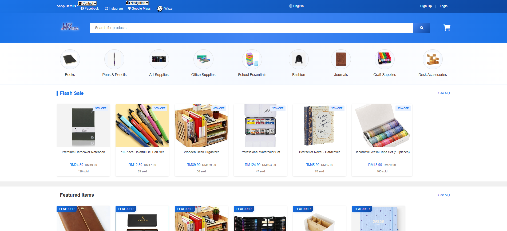

# MaxLida Stationery Shop

**A front-end e-commerce website for a stationery and book store, with a customer shop, a cart and checkout flow, and separate admin and staff dashboards. Available in English and Malay.**

MaxLida is a fictional shop. The site's look is inspired by Shopee but adapted to stationery, books and office supplies. It is built with plain HTML, CSS and JavaScript and has **no backend**: accounts, orders and reviews are kept in the browser's `localStorage`, which makes it a good demo and learning project.

> A group project. UiTM, 2025.

<table align="center">
  <tr>
    <td align="center"><br><em>Home</em></td>
  </tr>
</table>

---

## Features

### Customer shop
- **Home page** with category navigation (Books, Pens & Pencils, Art Supplies, Office Supplies, School Essentials and more), a flash-sale countdown and a product grid.
- **Category pages** (Books, Office Supplies and other categories) and a **product detail** page with price, quantity selector, add-to-cart button, rating and customer reviews.
- **Cart** with select-all and individual items, quantity changes, delete and an automatically calculated total.
- **Checkout** with a choice of **delivery** (with address) or **pickup**, and payment options for online banking (FPX), credit or debit card and TNG e-wallet.
- **Voucher code:** enter `MAXLIDA10` at checkout for 10% off the merchandise subtotal.
- **Sign up and login** for customers, and an **orders** page with an **order detail** page for each order.
- **English and Malay** interface, with a language switch that is remembered.

### Admin dashboard
- **Dashboard overview** with summary cards, recent orders and sales figures.
- **Inventory management**, **product management** (add new products) and **order management**.
- **Customer reviews**, **staff management**, **sales reports** and **settings** (general, store, payment, shipping and notifications).

### Staff dashboard
- A reduced view for staff: overview, recent orders, new reviews, inventory and product management.

## Demo accounts and data

This is a classroom demo, so there is no real authentication or database.

| Where | Details |
| :--- | :--- |
| Admin login (`admin_login.html`) | Staff ID `admin`, password `admin123` opens the admin dashboard |
| Staff login (`admin_login.html`) | Staff ID `staff`, password `staff123` opens the staff dashboard |
| Customer accounts | Create one on the sign-up page. It is stored in your browser only |

- The credentials above are written in the page's JavaScript, so anyone can read them. They are **not secure**.
- Customer passwords are saved in plain text in `localStorage`. **Do not use a real password.**
- Placing an order at checkout saves it in `localStorage` (`orders` and `orderList`), and the dashboards read it from there. Clearing your browser data removes it.
- Many numbers and tables in the dashboards, and the sample orders, are fixed demo content.

## Tech stack

- **HTML5, CSS3 and vanilla JavaScript.** No framework and no build step.
- **`localStorage`** for accounts, orders, reviews and language.
- **Font Awesome** icons.
- **`language.js`** holds all English and Malay text. Elements use `data-lang-key` attributes to pick their translation.

## Project structure

```
StationeryShop/
├── index.html              # Home page
├── login.html              # Customer login
├── sign_up.html            # Customer sign up
├── category.html           # Category page (books)
├── office_supplies.html    # Office supplies page
├── product-detail.html     # Product page
├── cart.html               # Shopping cart
├── checkout.html           # Checkout and payment
├── orders.html             # Order history
├── order-detail.html       # Single order
├── admin_login.html        # Admin and staff login
├── admin_dashboard.html    # Admin dashboard
├── staff_dashboard.html    # Staff dashboard
├── styles.css              # Shared styles
├── script.js               # Shared scripts
├── language.js             # English and Malay translations
└── images/                 # Product, category and payment images
```

## Run it

There is nothing to install.

```bash
git clone https://github.com/malsaaaa/StationeryShop.git
cd StationeryShop
```

Open `index.html` in your browser. If you prefer a local server (recommended, because `localStorage` is kept per address):

```bash
python -m http.server 8000
```

Then open http://localhost:8000.

### Suggested walkthrough
1. Create a customer account on **Sign Up**, then log in.
2. Open a product, add it to the cart, and go through **Checkout** (try the voucher `MAXLIDA10`).
3. Open **Orders** to see the order.
4. Go to the admin login (`admin` / `admin123`) to see it in the **Admin dashboard**.

## Limitations

- There is no backend, so nothing is shared between browsers or devices.
- The product catalog is written directly in the HTML pages. There is no product database.
- Login for staff and admins is a client-side demo only.
- Pages contain their own styles and scripts, so some code is repeated across files.
- Payments are not processed. The payment options are only for show.

## Credits

- Product and category images are placeholders for a demo store. Check the rights to any image you reuse.

## License

Copyright (c) 2025 the project team. All rights reserved.

This repository is public for viewing and portfolio purposes. No license is granted to copy, modify, distribute or use the code without the team's written permission.
